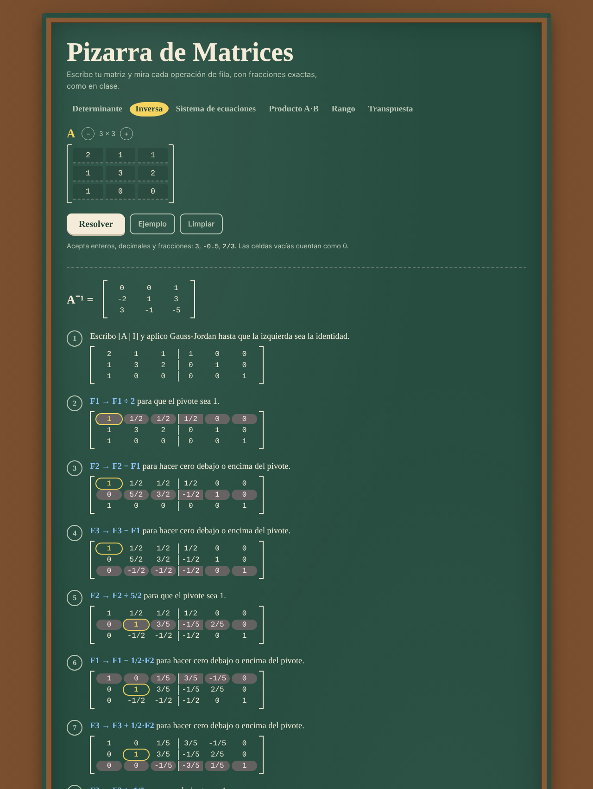

# Pizarra de Matrices

Calculadora de matrices que **muestra cada operación de fila**, como se resuelve en el pizarrón. Trabaja con **fracciones exactas**: 1/3 sigue siendo 1/3, no 0.3333.

**Pruébala:** https://acruzc23-crypto.github.io/calculadora-matrices/



## Operaciones

| Operación | Método | Qué muestra |
| --- | --- | --- |
| Determinante | Eliminación hasta forma triangular | Cada operación de fila, los intercambios que cambian el signo y el producto de la diagonal |
| Inversa | Gauss-Jordan sobre [A \| I] | Cada paso hasta llegar a la identidad, o por qué no existe |
| Sistema de ecuaciones | Gauss-Jordan sobre [A \| b] | Solución única, infinitas soluciones con la variable libre, o sin solución |
| Producto A·B | Fila por columna | El cálculo de cada elemento c<sub>ij</sub> |
| Rango | Forma escalonada | Cuántas filas tienen pivote |
| Transpuesta | | Filas convertidas en columnas |

- Matrices de hasta 6 × 6.
- Acepta enteros, decimales (`0.5` o `0,5`) y fracciones (`2/3`), y avisa qué celda tiene un valor no válido.
- El pivote se marca en amarillo y la fila que cambia, en rosa.

## Cómo está hecho

- `src/fraccion.js`: fracciones con `BigInt`, siempre simplificadas.
- `src/matrices.js`: los algoritmos. Cada uno devuelve el resultado y la lista de pasos con una copia de la matriz en ese momento.
- `src/app.js`: la interfaz. Sin frameworks ni dependencias.

```bash
npm test                 # 7 pruebas (incluye que A · A⁻¹ = I)
python3 -m http.server   # y abrir http://localhost:8000
```

## Contexto

Lo hice para practicar Álgebra Lineal (UNEMI) y comprobar mis ejercicios. El código se escribió con ayuda de Claude (IA de Anthropic); yo definí qué debía hacer, lo revisé y lo probé.

Alfredo Cruz, estudiante de Ingeniería en Software, Milagro, Ecuador.

## Licencia

MIT
